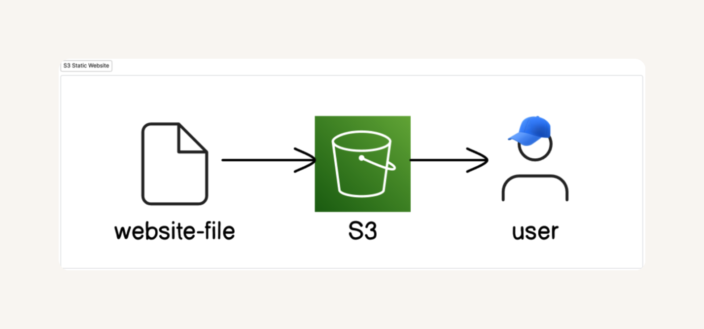

# 🟢 Project 1 – Static Website Hosting on Amazon S3

This repository is my first project where I demonstrates how to deploy and host a **static website** using **Amazon S3**.

---

## 🗂️ What I Did

-Set up and configured an Amazon **S3 bucket** with public access and versioning enabled.
-Uploaded HTML and CSS assets into the bucket.
-Activated static website hosting and obtained the endpoint URL.
-Resolved access issues by applying bucket policies and ACLs.

---

## 🖼️ Architecture Diagram

---

## 📄 Endpoint URL

You can view the website here:  
[My S3 Static Website](http://test-satu.s3-website.ap-southeast-5.amazonaws.com/)

---

## 🔖 Tags

`#AWS` `#AmazonS3` `#StaticWebsiteHosting` `#AWSBeginnersChallenge` `#NextWork`
